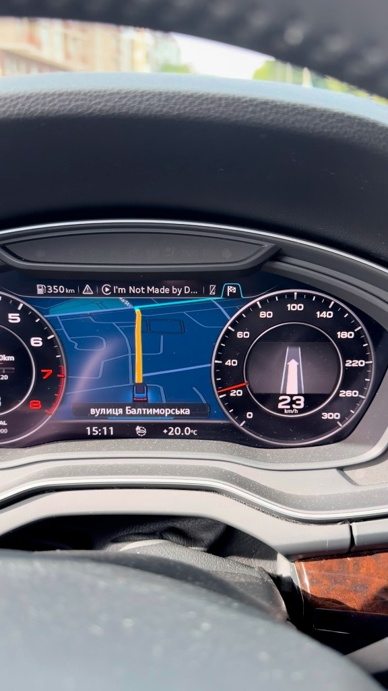
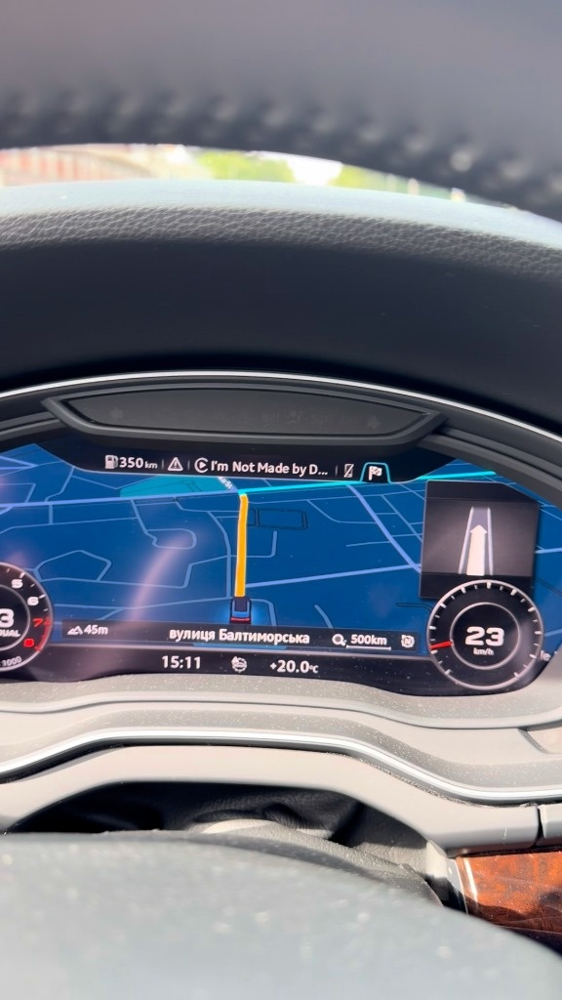

# CarPlay on the Audi Virtual Cockpit: AltScreen V3.8 Fix1 + fork additions

**English** | [Українська](README_UA.md) · upstream docs: [English](README_EN.md) · [简体中文](README_CN.md)

This repository is a fork of **[yuedizhibo/MHI2Q-CarPlay-AltScreen](https://github.com/yuedizhibo/MHI2Q-CarPlay-AltScreen)**
(by yuedizhibo and Lanye-z) at **V3.8 Fix1**. It shows the native CarPlay cluster map on the Audi
**MHI2Q** Virtual Cockpit, with route guidance arrows and lanes, the CarPlay phone tab on the cluster,
arrival time in the lower info bar and the iPhone's maneuver card. A few additions of this fork come
on top; everything else is upstream's, unchanged.

Until October 2026 this repository was a hybrid of an early AltScreen release and
[luka-dev/mib2q-carplay-rgi](https://github.com/luka-dev/mib2q-carplay-rgi). Both upstreams now cover
what the hybrid was built for, so the fork moved onto AltScreen V3.8, which already carries the RGI
Java and the maneuver renderer from this repository. The last hybrid is the tag `hybrid-final`.

**Use at your own risk.** The installer changes system files of the head unit. Read upstream's
[README](README_EN.md) completely before installing, keep the `MMI-Cockpit-Carplay` folder of your SD
card (it holds the stock backups) and never install while driving.

<p align="center">
  
  <br />
  <sub>CarPlay map on the Virtual Cockpit, Classic and Sport (Audi Q5 FY, MU1329)</sub>
</p>

## What V3.8 Fix1 brings

From upstream, see its [changelog](README_EN.md#changelog) for details:

- CarPlay cluster map, Classic / Sport, FULL / SMALL views, steering-wheel zoom, 30 fps source-driven display;
- NV12 → RGBA on the GPU (head unit CPU about 80 % → 20 %);
- fixed TCP port 6031 in the firewall configs: no black cluster on cold start, no drop when LTE changes IP;
- the second screen waits until the stock cluster map is up on a cold start;
- full RGI: turn arrows, lane guidance (lanes no longer vanish after the route start);
- CarPlay calls on the cluster phone tab, arrival time after the road name, the iPhone's maneuver card;
- one-step INSTALL that removes an older version first, RESTORE ORIGINAL, rescue restore, cards copied on a Mac.

## Fork additions

Green menu → `Customization` → `MMI-Cockpit-Carplay`, below upstream's entries:

| Menu entry | What it does | Applies |
|---|---|---|
| `Cluster map area: full / 1200 / 1140 / 1080 px` | Tells the iPhone a narrower cluster view area, starting at the left edge. Amap and Baidu ignore the safe area and put the vehicle right of the view area's centre; a narrower view area brings it back to the middle. Apple / Google Maps follow the safe area, which does not move. With the phone card (`INSTALL WITH ... CARD`) the minimum is 1140 px. | next phone connection |
| `Cluster map shift: off / Sport test` | Moves the map on the cluster by a fixed offset on top of the stock placement. *Sport test* puts the SMALL view (VIEW button) of a Classic car where Sport has it (−476 px). Sport cars already get that from the stock layout. | right away |
| `Dump cluster video to SD (diagnostic)` | Copies the last few MB of the received cluster H.264 stream to `MMI-Cockpit-Carplay/logs/h264/`. Analyse it with `python3 Tools/h264_ring_analyze.py <file>`. | – |
| `Verbose Java logs: on / off` | Creates or removes `/mnt/app/carplay_verbose`: the Java HMI also logs INFO (the native hooks already do while installed). RESTORE ORIGINAL removes it. | next phone connection |
| `Map bottom edge: normal / 420 / 400 / 380` | Moves the bottom edge of the cluster safe area up from V3.8's y=450. Google Maps and Waze put the vehicle just above that edge, so it moves up and clears the stock lower info bar (road name \| arrival time). | next phone connection |
| `Card in small view: keep / hide` | With `INSTALL WITH ... CARD`. *Keep* (default): the phone's card screen stays in the SMALL view too, so VIEW only resizes the drawing area and the map no longer rebuilds (jumps, grey frame) on every press. *Hide*: V3.8 behaviour, map-only screen in SMALL. | next VIEW press |
| `RGI backing: on / off` | *On* (default): the dark stock KDK panel sits under the route arrow and fades with it, as before V3.8 Fix1, so the map does not show through the maneuver panel. *Off*: the arrow sits directly on the map (V3.8 Fix1). | within 2 s |
| `REPAIR CONFIG AFTER HYBRID` | One-off: puts `smartphone_integrator.json` / `dio_manager.json` back to stock from files prepared on the SD (`MMI-Cockpit-Carplay/repair-after-hybrid/`), only from the expected broken state, saving everything first. For a unit where the hybrid's RESTORE left a config that no longer starts CarPlay. | after a reboot |

Area and shift live in the installed runtime (`/mnt/app/root/carplay-altscreen/state/`), so a new INSTALL
resets them, as it does the card position. The hook logs `ALTAREA_VIEW_WIDTH`, the map display logs
`PHASE=USER_MAP_SHIFT`; both are in the boot logs on the SD.

The code changes are small and marked "MMI-Cockpit-Carplay fork":

| File | Change |
|---|---|
| `Toolbox/carplay_alt_screen/src/p1404_airplay.c` | `alt_cluster_view_width()`: optional view-area width; `alt_safe_height()`: optional safe-area bottom; `alt_phone_card_mode()`: card kept in SMALL |
| `Toolbox/carplay_alt_screen/mirror_display/src/cluster_shift.h`, `main.cpp` | per-view user offset |
| `Toolbox/scripts/cluster_area*.sh`, `cluster_shift*.sh`, `dump_cluster_h264.sh`, `rgi_verbose*.sh` | GEM scripts |
| `Toolbox/GEM/mqb-carplayAltScreen.esd` | the menu entries above |
| `Toolbox/scripts/altscreen_restore_apply.sh` | RESTORE removes the verbose-log marker |
| `Toolbox/scripts/repair_after_hybrid.sh`, `Tools/prepare_repair_after_hybrid.py` | stock config back after the hybrid |
| `Toolbox/carplay_alt_screen/hmi/src/com/luka/carplay/cluster/ClusterLayerController.java` | RGI backing under the arrow (switch file `state/rgi-backing-off`) |
| `Toolbox/carplay_alt_screen/mirror_display/assets/logo_frames.z` | startup clip (`Tools/make_startup_rings.py`, 3.2 s): arc pieces spin around the four rings in alternating directions and grow into them under a zoom-out, with trailing lines and a white bloom that settles to a soft halo |

Not ported from the hybrid, because V3.8 does it itself: the cluster layout menu (V3.8 has
`CARD LEFT/TOP/RIGHT` and moved the ETA to the info bar), the 30 fps binary patch, the Sport video
placement, steering-wheel zoom, the MU1003 Java variant, the stock touchpad, RESTORE skipping files
that still match the backup.

**Tested in a car** (Audi Q5 FY, `MHI2Q_ER_AUG22_P5092`, MU1329, 2026-10-31): installs with
`INSTALL WITH RGI` and `INSTALL WITH RGI CARD`, CarPlay map on the cluster, route arrow with its
backing, the rings startup clip, the map bottom edge, the card kept in the small view (VIEW no longer
rebuilds the map), and `REPAIR CONFIG AFTER HYBRID` on a unit left broken by the hybrid's RESTORE.
Not yet checked in a car: the cluster map area and shift, the H.264 dump.

## Building the SD card

Needs Docker and your unit's stock HMI jar (for the JAR). The fork rebuilds only the three
binaries it changes; `libcarplay_rgi_meta.so` and `maneuver_render` come from upstream's V3.8 Fix1
release, each checked against `SHA256SUMS-SD.txt` before use.

| Binary | Toolchain |
|---|---|
| `libcarplay_altscreen.so` | Debian clang/LLD 19.1.7 in an image built from `docker/hook.Dockerfile` (automatic). Upstream's unmodified sources built with it give the release library byte for byte. |
| `carplay-alt111-mirror-display` | QNX 6.5 SDP + GCC 8.5, image `qnx65-armv7-toolchain` from [luka-dev/qnx65-armv7-toolchain](https://github.com/luka-dev/qnx65-armv7-toolchain), built once. Upstream's sources built with it pass upstream's marker checks and link the same libraries, but are not byte-identical to the release: upstream used another GCC 8.5 build, ours links that image's libgcc helpers (+316 bytes of code). |
| `carplay_hook-basevideo3.jar` | `scripts/build_hmi_jar.sh`: javac 1.8 in `eclipse-temurin:8`, against upstream's release JAR and your own stock HMI jar (`STOCK_JAR=`, default `~/Tools/jxe2jar/out/MU1329-base.jar`). It first compiles upstream's version of each changed class and requires the release JAR's bytes, then replaces only those classes. |

```sh
git clone https://github.com/luka-dev/qnx65-armv7-toolchain
(cd qnx65-armv7-toolchain && ./host-scripts/qnx-run.sh build 8.5 && docker tag qnx65-armv7-toolchain:8.5 qnx65-armv7-toolchain:latest)
```

```sh
./scripts/build_sd.sh                       # build/native/ + build/sd/ (downloads the V3.8 Fix1 release once)
SD=/Volumes/SDCARD ./scripts/build_sd.sh    # also write it onto the card
./scripts/run_checks.sh                     # host checks: scripts, GEM menu, shift parser, ARM compile
```

`build/sd/` is a complete card: the MIB2 Toolbox from `sd_base/` (as in the V3.8 Fix1 release) plus the
AltScreen overlay and the fork's files, with `SHA256SUMS-SD.txt`. `SD=` replaces
`Toolbox/carplay_alt_screen/` on the card and never touches `MMI-Cockpit-Carplay/`.

## Installing

As upstream describes in [Installation and testing](README_EN.md#installation-and-testing): green menu
`MQBCoding → Update Toolbox`, then one `INSTALL WITH ...` entry under `MMI-Cockpit-Carplay`, wait for
`RESULT: SUCCESS`, reboot the head unit once.

### Coming from the hybrid

The hybrid installed luka's RGI hook next to AltScreen (`rgi_companion.sh`). V3.8's automatic uninstall
does not know those files and would refuse. So:

1. With the **old** card: `MMI-Cockpit-Carplay → RESTORE ORIGINAL`, wait for `RESULT`, reboot.
2. Write the new card with `SD=... ./scripts/build_sd.sh` (it stops if the card still has the
   hybrid's `Toolbox/carplay_alt_screen/rgi/`; remove that folder after step 1). Keep `MMI-Cockpit-Carplay/`.
3. `MQBCoding → Update Toolbox`, check that the menu shows `Version: V3.8 Fix1 + fork ...`, then INSTALL.

If INSTALL stops at step 1 with *Stock backup does not match this head unit* and the log says
`trusted original backup unavailable; project/legacy configuration remains`, or CarPlay does not start
at all after the hybrid's RESTORE: the hybrid's "original" backup was taken over an earlier install,
so its RESTORE wrote back a config that starts CarPlay through the hybrid's (now deleted)
`/mnt/app/root/hooks/carplay_startup.sh`. Fix it with `REPAIR CONFIG AFTER HYBRID`:

1. Find a backup from **before** the hybrid: `MMI-Cockpit-Carplay/backup/ORIGINAL/files/` of an older
   card or a copy of it (an AltScreen-only install is fine).
2. Prepare the repair files on the new card:

   ```sh
   python3 Tools/prepare_repair_after_hybrid.py \
       --broken /Volumes/<hybrid card>/MMI-Cockpit-Carplay/backup/ORIGINAL/files \
       --clean <older backup>/MMI-Cockpit-Carplay/backup/ORIGINAL/files \
       --out /Volumes/<new card>/MMI-Cockpit-Carplay/repair-after-hybrid
   ```

3. In the car: `REPAIR CONFIG AFTER HYBRID` → `RESULT: SUCCESS` → reboot → check that stock CarPlay
   works → INSTALL. It only acts when the head unit's files are exactly the expected broken state and
   saves everything it changes to `repair-after-hybrid/before_<n>/` first.

## Licenses

As upstream (see [NOTICE.md](Toolbox/carplay_alt_screen/NOTICE.md)): the AltScreen hook, the map
display, scripts, the green menu and documentation are under
[PolyForm Noncommercial 1.0.0 + additional terms](Toolbox/carplay_alt_screen/LICENSE.ADDITIONAL-TERMS.md):
free for personal use, no selling. The Java HMI and RGI (`hmi/`, `rgi_native/`, `rgi_renderer/`) are
GPL-3.0. The MIB2 Toolbox in `sd_base/` is MIT ([jilleb/mib2-toolbox](https://github.com/jilleb/mib2-toolbox)).
The fork's changes follow the license of the part they change.

## Credits

[yuedizhibo](https://github.com/yuedizhibo) and [Lanye-z](https://github.com/Lanye-z) (CarPlay AltScreen),
[luka-dev](https://github.com/luka-dev) (route guidance, telephony, QNX toolchain),
[jilleb](https://github.com/jilleb/mib2-toolbox) (MIB2 Toolbox).
