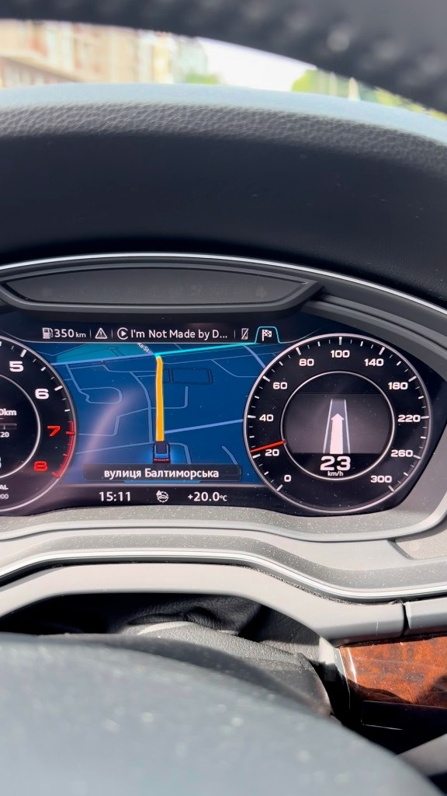
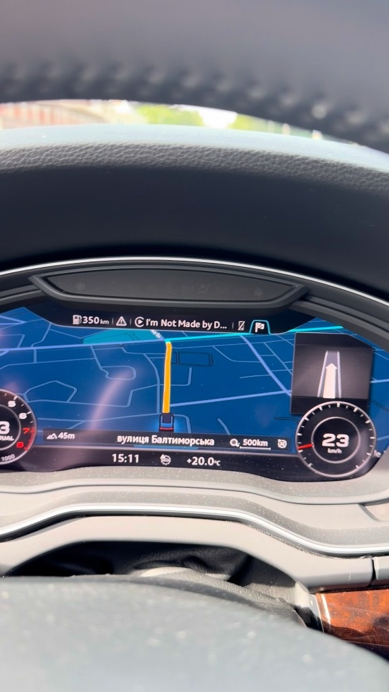

# CarPlay на Audi Virtual Cockpit: AltScreen V3.8 Fix1 + доповнення форку

[English](README.md) | **Українська** · документація апстріму: [English](README_EN.md) · [简体中文](README_CN.md)

Цей репозиторій — форк **[yuedizhibo/MHI2Q-CarPlay-AltScreen](https://github.com/yuedizhibo/MHI2Q-CarPlay-AltScreen)**
(автори yuedizhibo та Lanye-z) версії **V3.8 Fix1**. Він показує рідну мапу CarPlay на Virtual Cockpit
Audi **MHI2Q** разом зі стрілками маршруту та смугами руху, вкладкою телефону CarPlay на приладці, часом
прибуття в нижньому рядку та карткою маневру від iPhone. Зверху додано кілька можливостей форку; усе
інше — без змін з апстріму.

До жовтня 2026 року тут був гібрид ранньої версії AltScreen та
[luka-dev/mib2q-carplay-rgi](https://github.com/luka-dev/mib2q-carplay-rgi). Тепер обидва апстріми
вміють те, заради чого робився гібрид, тож форк перейшов на AltScreen V3.8, де вже є RGI Java та
рендерер маневрів із цього репозиторію. Останній гібрид — тег `hybrid-final`.

**На власний ризик.** Інсталятор змінює системні файли головного блоку. Повністю прочитайте
[README апстріму](README_EN.md) перед встановленням, зберігайте теку `MMI-Cockpit-Carplay` на SD-карті
(там резервні копії стокових файлів) і ніколи не встановлюйте під час руху.

<p align="center">
  
  <br />
  <sub>Мапа CarPlay на Virtual Cockpit, Classic та Sport (Audi Q5 FY, MU1329)</sub>
</p>

## Що дає V3.8 Fix1

З апстріму, подробиці в його [журналі змін](README_EN.md#changelog):

- мапа CarPlay на приладці, Classic / Sport, види FULL / SMALL, зум коліщатком керма, 30 fps без фіксованого періоду;
- перетворення NV12 → RGBA на GPU (завантаження CPU блоку приблизно 80 % → 20 %);
- фіксований TCP-порт 6031 у конфігураціях брандмауера: немає чорної приладки після холодного старту та обривів, коли LTE змінює IP;
- після холодного старту другий екран чекає, доки підніметься стокова мапа приладки;
- повний RGI: стрілки поворотів, смуги руху (смуги більше не зникають після початку маршруту);
- дзвінки CarPlay на вкладці телефону приладки, час прибуття після назви вулиці, картка маневру від iPhone;
- INSTALL в один крок із попереднім видаленням старої версії, RESTORE ORIGINAL, аварійне відновлення, карти, скопійовані на Mac.

## Доповнення форку

Зелене меню → `Customization` → `MMI-Cockpit-Carplay`, під пунктами апстріму:

| Пункт меню | Що робить | Коли діє |
|---|---|---|
| `Cluster map area: full / 1200 / 1140 / 1080 px` | Повідомляє iPhone вужчу область (view area) мапи на приладці, від лівого краю. Amap і Baidu ігнорують safe area й ставлять автомобіль правіше від центру view area; вужча область повертає його до середини. Apple / Google Maps орієнтуються на safe area, яка не зсувається. З карткою iPhone (`INSTALL WITH ... CARD`) мінімум — 1140 px. | з наступним підключенням телефону |
| `Cluster map shift: off / Sport test` | Зсуває мапу на приладці на фіксовану величину понад стокове розташування. *Sport test* ставить вид SMALL (кнопка VIEW) на автомобілі з Classic туди, де він у Sport (−476 px). На Sport це вже робить стокова розкладка. | одразу |
| `Dump cluster video to SD (diagnostic)` | Копіює останні кілька МБ отриманого H.264-потоку приладки в `MMI-Cockpit-Carplay/logs/h264/`. Аналіз: `python3 Tools/h264_ring_analyze.py <файл>`. | – |
| `Verbose Java logs: on / off` | Створює або видаляє `/mnt/app/carplay_verbose`: Java HMI пише також INFO (нативні хуки вже роблять це, поки встановлені). RESTORE ORIGINAL його видаляє. | з наступним підключенням телефону |
| `RGI backing: on / off` | *On* (типово): під стрілкою маршруту темна стокова панель KDK, що з'являється і гасне разом зі стрілкою, як до V3.8 Fix1, тож мапа не просвічує крізь панель маневру. *Off*: стрілка просто поверх мапи (V3.8 Fix1). | за 2 с |
| `REPAIR CONFIG AFTER HYBRID` | Одноразово: повертає стокові `smartphone_integrator.json` / `dio_manager.json` з файлів, підготовлених на SD (`MMI-Cockpit-Carplay/repair-after-hybrid/`), лише з очікуваного зламаного стану і спершу все зберігши. Для блоку, де RESTORE гібрида залишив конфіг, з яким CarPlay не стартує. | після перезавантаження |

Область і зсув зберігаються у встановленому runtime (`/mnt/app/root/carplay-altscreen/state/`), тому
новий INSTALL їх скидає, як і положення картки. Хук пише в лог `ALTAREA_VIEW_WIDTH`, дисплей мапи —
`PHASE=USER_MAP_SHIFT`; обидва потрапляють у логи завантаження на SD.

Зміни в коді невеликі й позначені "MMI-Cockpit-Carplay fork":

| Файл | Зміна |
|---|---|
| `Toolbox/carplay_alt_screen/src/p1404_airplay.c` | `alt_cluster_view_width()`: необов'язкова ширина view area |
| `Toolbox/carplay_alt_screen/mirror_display/src/cluster_shift.h`, `main.cpp` | зсув для кожного виду |
| `Toolbox/scripts/cluster_area*.sh`, `cluster_shift*.sh`, `dump_cluster_h264.sh`, `rgi_verbose*.sh` | скрипти GEM |
| `Toolbox/GEM/mqb-carplayAltScreen.esd` | пункти меню вище |
| `Toolbox/scripts/altscreen_restore_apply.sh` | RESTORE видаляє маркер детальних логів |
| `Toolbox/carplay_alt_screen/hmi/src/com/luka/carplay/cluster/ClusterLayerController.java` | підкладка RGI під стрілкою (файл-перемикач `state/rgi-backing-off`) |
| `Toolbox/carplay_alt_screen/mirror_display/assets/logo_frames.z` | заставка: чотири кільця на чорному (`Tools/make_startup_rings.py`), 3 с |

З гібрида не перенесено, бо V3.8 робить це сама: меню розкладки мапи (у V3.8 є `CARD LEFT/TOP/RIGHT`,
а ETA перенесено в нижній рядок), бінарний патч 30 fps, розташування відео на Sport, зум коліщатком,
Java-варіант для MU1003, стоковий тачпад, пропуск у RESTORE файлів, що збігаються з резервною копією.

**Ще не перевірено в автомобілі:** область мапи, зсув і два перезібрані бінарники. Першу карту з
цього форку вважайте тестовою.

## Збирання SD-карти

Потрібен Docker і стоковий HMI jar вашого блоку (для JAR). Форк перезбирає лише три бінарники, які
змінює; `libcarplay_rgi_meta.so` і `maneuver_render` беруться з релізу V3.8 Fix1 апстріму, кожен
перевіряється за `SHA256SUMS-SD.txt`.

| Бінарник | Тулчейн |
|---|---|
| `libcarplay_altscreen.so` | Debian clang/LLD 19.1.7 в образі з `docker/hook.Dockerfile` (автоматично). Незмінені джерела апстріму дають ним побайтно ту саму бібліотеку, що в релізі. |
| `carplay-alt111-mirror-display` | QNX 6.5 SDP + GCC 8.5, образ `qnx65-armv7-toolchain` з [luka-dev/qnx65-armv7-toolchain](https://github.com/luka-dev/qnx65-armv7-toolchain), збирається один раз. Джерела апстріму, зібрані ним, проходять перевірки маркерів апстріму й підключають ті самі бібліотеки, але побайтно не збігаються з релізом: апстрім використав іншу збірку GCC 8.5, наша підтягує допоміжні функції libgcc з цього образу (+316 байт коду). |
| `carplay_hook-basevideo3.jar` | `scripts/build_hmi_jar.sh`: javac 1.8 в `eclipse-temurin:8`, проти релізного JAR апстріму та вашого стокового HMI jar (`STOCK_JAR=`, типово `~/Tools/jxe2jar/out/MU1329-base.jar`). Спершу компілює версію апстріму кожного зміненого класу й вимагає байтів релізного JAR, потім замінює лише ці класи. |

```sh
git clone https://github.com/luka-dev/qnx65-armv7-toolchain
(cd qnx65-armv7-toolchain && ./host-scripts/qnx-run.sh build 8.5 && docker tag qnx65-armv7-toolchain:8.5 qnx65-armv7-toolchain:latest)
```

```sh
./scripts/build_sd.sh                       # build/native/ + build/sd/ (реліз V3.8 Fix1 завантажується один раз)
SD=/Volumes/SDCARD ./scripts/build_sd.sh    # і записати на карту
./scripts/run_checks.sh                     # перевірки на комп'ютері: скрипти, меню GEM, парсер зсуву, компіляція під ARM
```

`build/sd/` — повна карта: MIB2 Toolbox з `sd_base/` (як у релізі V3.8 Fix1) плюс оверлей AltScreen і
файли форку, з `SHA256SUMS-SD.txt`. `SD=` замінює `Toolbox/carplay_alt_screen/` на карті й ніколи не
чіпає `MMI-Cockpit-Carplay/`.

## Встановлення

Як описано в апстрімі ([Installation and testing](README_EN.md#installation-and-testing)): зелене меню
`MQBCoding → Update Toolbox`, далі один із пунктів `INSTALL WITH ...` у `MMI-Cockpit-Carplay`, дочекатися
`RESULT: SUCCESS`, один раз перезавантажити головний блок.

### Перехід із гібрида

Гібрид встановлював RGI-хук luka поруч з AltScreen (`rgi_companion.sh`). Автоматичне видалення V3.8 не
знає цих файлів і відмовить. Тому:

1. Зі **старою** картою: `MMI-Cockpit-Carplay → RESTORE ORIGINAL`, дочекатися `RESULT`, перезавантажити.
2. Записати нову карту через `SD=... ./scripts/build_sd.sh` (скрипт зупиниться, якщо на карті ще є
   `Toolbox/carplay_alt_screen/rgi/` гібрида; видаліть цю теку після кроку 1). Теку `MMI-Cockpit-Carplay/` залишити.
3. `MQBCoding → Update Toolbox`, переконатися, що меню показує `Version: V3.8 Fix1 + fork ...`, і виконати INSTALL.

## Ліцензії

Як в апстрімі (див. [NOTICE.md](Toolbox/carplay_alt_screen/NOTICE.md)): хук AltScreen, дисплей мапи,
скрипти, зелене меню та документація — під
[PolyForm Noncommercial 1.0.0 + додаткові умови](Toolbox/carplay_alt_screen/LICENSE.ADDITIONAL-TERMS.md):
безкоштовно для особистого використання, продавати не можна. Java HMI та RGI (`hmi/`, `rgi_native/`,
`rgi_renderer/`) — GPL-3.0. MIB2 Toolbox у `sd_base/` — MIT ([jilleb/mib2-toolbox](https://github.com/jilleb/mib2-toolbox)).
Зміни форку мають ліцензію тієї частини, яку змінюють.

## Подяки

[yuedizhibo](https://github.com/yuedizhibo) та [Lanye-z](https://github.com/Lanye-z) (CarPlay AltScreen),
[luka-dev](https://github.com/luka-dev) (route guidance, телефонія, QNX-тулчейн),
[jilleb](https://github.com/jilleb/mib2-toolbox) (MIB2 Toolbox).
